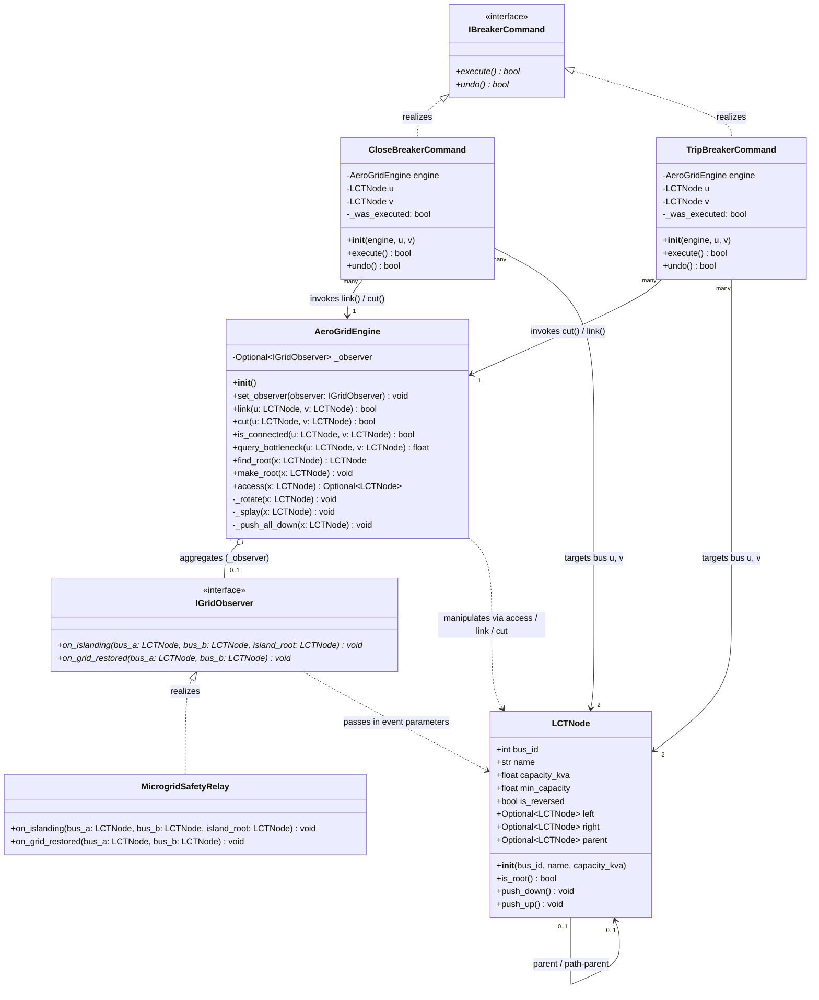

# AeroGrid-LCT: Real-Time Dynamic Electrical Network Connectivity and Partitioning Engine for Decentralized Microgrids

An autonomous, zero-database, in-memory electrical topology tracking and islanding detection engine engineered in Python. The system is architected around a single advanced data structure: the **Sleator-Tarjan Link-Cut Tree (LCT)**.

---

## 1. Problem Statement & Real-World Domain
Modern power grids are transitioning into decentralized microgrids with distributed renewable sources (Solar PV, Battery Energy Storage Systems, localized gensets). During electrical faults, physical circuit breakers trip within milliseconds, creating isolated sub-networks ("electrical islands").

Conventional software architectures fail in high-voltage physical grids:
- **Relational / Time-Series Databases:** High I/O, disk logging, and serialization latencies (10–500 ms) violate microsecond arc-fault protection windows.
- **Static Graph Algorithms (BFS/DFS):** Require full $O(V + E)$ graph traversals on every breaker trip, creating computational lag across large feeder networks.
- **Disjoint-Set Union (DSU):** Does not support edge deletions (`cut`) because path compression destroys tree hierarchy.

**AeroGrid-LCT** executes edge insertions (`link`), breaker trips (`cut`), reachability checks (`find_root`), and transmission path bottleneck queries in amortized $O(\log V)$ time with a strict $O(V)$ memory footprint.

---

## 2. Team Architecture & Modular Split

| Member | Module File | Architectural Responsibility |
| :--- | :--- | :--- |
| **Member 1** | `lct_node.py` | Core dynamic node structure, path-parent pointer mechanics, and lazy propagation (`push_down`, `push_up`). |
| **Member 2** | `grid_engine.py` | Link-Cut Tree primitives (`_rotate`, `_splay`, `access`, `make_root`, `link`, `cut`, `find_root`). |
| **Member 3** | `grid_patterns.py` | Software architecture: Command Pattern for breaker rollback (`undo`) and Observer Pattern for safety relay alarms. |
| **Member 4** | `main_simulation.py` | Faculty test verification, edge-case assertions (cycles, invalid cuts), and interactive demo CLI. |

---

## 3. Complexity Comparison Matrix

| Operation | Adjacency List + BFS/DFS | Disjoint Set Union (DSU) | Link-Cut Tree (AeroGrid-LCT) |
| :--- | :--- | :--- | :--- |
| **Add Line (`link`)** | $O(1)$ | $O(\alpha(V))$ | **Amortized $O(\log V)$** |
| **Break Line (`cut`)** | $O(V)$ search + splice | **Unsupported** (Requires full rebuild) | **Amortized $O(\log V)$** |
| **Islanding Check** | $O(V + E)$ full search | $O(\alpha(V))$ | **Amortized $O(\log V)$** |
| **Path Bottleneck Query** | $O(V + E)$ path search | **Unsupported** | **Amortized $O(\log V)$** |
| **Memory Footprint** | $O(V + E)$ dynamic lists | $O(V)$ flat parent array | **$O(V)$ pure node pointers** |

---

## 4. System Architecture & UML Class Diagram

AeroGrid-LCT structures electrical telemetry and protection using two Gang-of-Four (GoF) design patterns:
1. **Command Pattern (`IBreakerCommand`):** Provides reversible switchgear actions (`CloseBreakerCommand`, `TripBreakerCommand`) with `.undo()` support for black-start recovery simulations.
2. **Observer Pattern (`IGridObserver`):** Pushes asynchronous notifications to physical protection relays (`MicrogridSafetyRelay`) upon detecting an electrical islanding condition.



---

## 5. How to Run
Ensure Python 3.8+ is installed:

```bash
# Verify base node implementation
python lct_node.py

# Verify engine primitives
python grid_engine.py

# Verify design patterns
python grid_patterns.py

# Run complete simulation and interactive CLI
python main_simulation.py
```